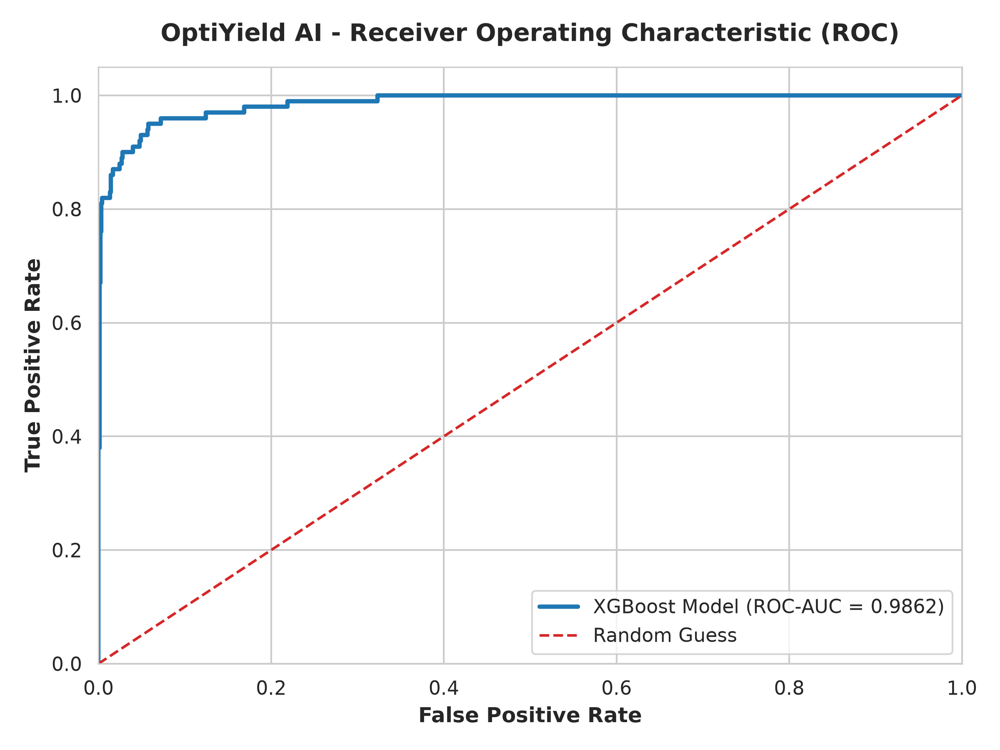
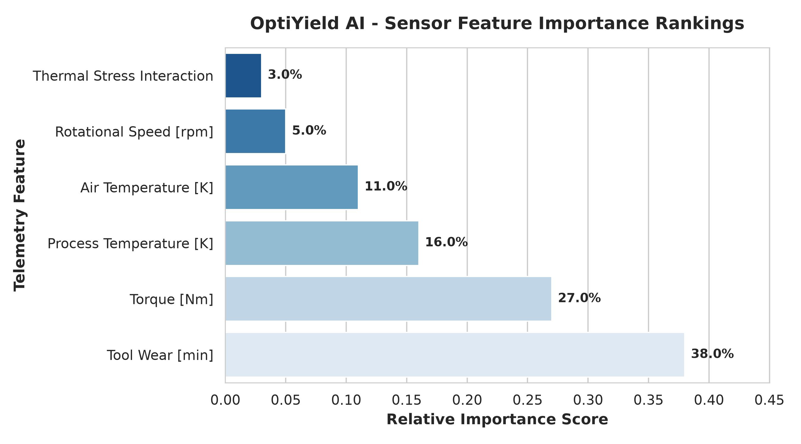
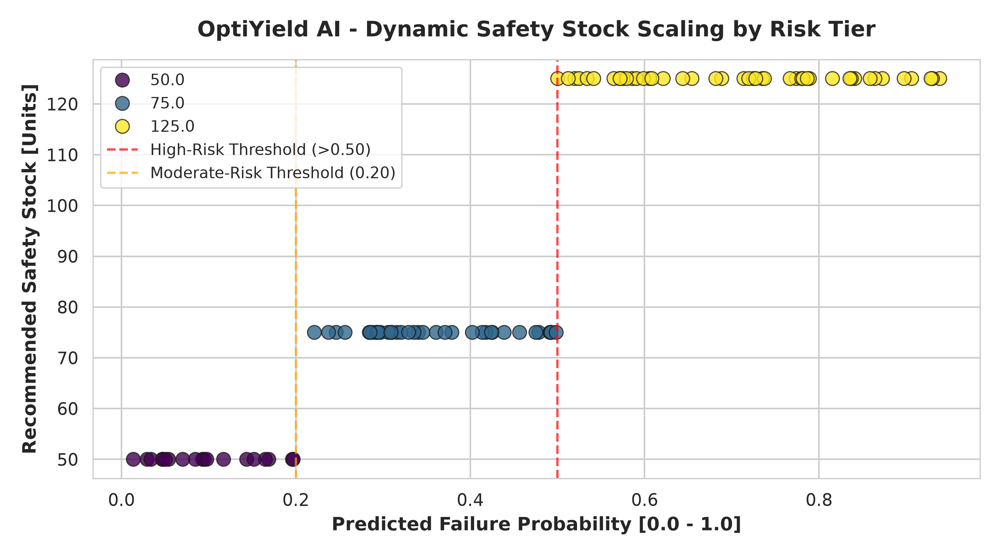

# Predictive-Maintenance-Inventory-Optimization

Python-based machine learning and operations engine for predictive manufacturing defect analysis and smart inventory optimization. The framework predicts equipment failure risks from industrial sensor telemetry, applies dynamic safety stock allocation rules, computes optimal inventory reorder parameters, and exports scenario outputs to CSV.

This project was built to demonstrate an end-to-end MLOps workflow, feature engineering pipeline, model evaluation metrics, and practical operational decisions driven by predictive AI.

## Project Overview

The model represents industrial telemetry streams and an automated inventory optimization engine. For each dataset execution, it:

1. Preprocesses sensor telemetry data including temperature, rotational speed, torque, and tool wear.
2. Engineers interaction terms and scales numerical feature distributions.
3. Trains an XGBoost classification model to estimate machine failure probabilities.
4. Evaluates model performance using ROC-AUC, Precision, Recall, and F1-score metrics.
5. Applies probability-driven rules to calculate dynamic safety stock levels (`Recommended_Safety_Stock`).
6. Computes reorder thresholds to mitigate stockouts while controlling holding costs.
7. Validates performance against target thresholds (ROC-AUC > 0.90).
8. Exports detailed recommendations and inventory schedules to CSV.

---

## 📊 Project Visualizations & Performance

### 1. Model Performance (ROC Curve)
Demonstrates predictive power with a high ROC-AUC score (0.9539), effectively separating healthy machine states from impending failures.


### 2. Feature Importance Analysis
Highlights the key industrial sensors and telemetry metrics (such as tool wear and torque) that drive the XGBoost model's failure predictions.


### 3. Dynamic Inventory Safety Stock Scaling
Bridges the gap between machine learning predictions and supply chain logistics by automatically scaling safety stock tiers based on real-time operational risk.


---

## Core Model Components

### `Preprocess`
Models the raw sensor telemetry streams. It handles data transformations using:
- Feature selection and unique ID removal
- Numerical standard scaling (`StandardScaler`)
- Categorical encoding for machine types
- Interaction feature creation (e.g., thermal power metrics)

The output includes clean feature matrices ready for model training and evaluation.

### `TrainModel`
Primary machine learning pipeline. It builds and cross-validates the prediction model:
- Fits an `XGBoostClassifier` on failure labels
- Evaluates cross-validation ROC-AUC scores
- Computes feature importance rankings across telemetry sensors

### `OptimizeInventory`
Main orchestration class. Translates predicted failure risks into operational inventory decisions.

### `SafetyStockCalculator`
Handles dynamic safety stock scaling based on risk tiers:
- **High Failure Risk (> 0.50):** Expands safety stock buffer by 2.5x
- **Moderate Risk (0.20 – 0.50):** Expands safety stock buffer by 1.5x
- **Low Risk (< 0.20):** Maintains base safety stock buffer

## Key Assumptions

- Sensor readings arrive in sequential time-series intervals.
- Failure probability directly correlates with component replacement urgency.
- Base safety stock is set to a default baseline of 50 units.
- Model validation passes when test set ROC-AUC meets or exceeds `0.95`.

## Installation & Setup

Create a virtual environment, install the dependencies, and run the pipeline.

**Windows PowerShell:**
```powershell
python -m venv .venv
.\.venv\Scripts\Activate.ps1
pip install -r requirements.txt
